# DeviceHub

IoT device management, edge telemetry gateway, anomaly detection, and advisory AI diagnostics — built and tested end-to-end in this repository.

Copyright © 2026 Parsa Fathi — Apache-2.0. See [LICENSE](LICENSE) and [THIRD_PARTY_NOTICES.md](THIRD_PARTY_NOTICES.md).

**Persian documentation:** [docs/fa/README_FA.md](docs/fa/README_FA.md)

---

## What DeviceHub does

DeviceHub is a self-contained IoT platform that exercises a complete edge-to-cloud data path:

- **Devices** publish telemetry and status over **real MQTT** (QoS 1) to an internal broker.
- An **edge gateway** service validates every message against the DeviceHub protocol v1, deduplicates deliveries, buffers to a **durable SQLite spool** that survives crashes, runs **deterministic automation rules at the edge**, routes commands, and forwards everything to the backend.
- A **Next.js backend** persists to a relational store (SQLite via Prisma in this deployment), enforces **role-based authentication** server-side, and exposes a REST API.
- A **Python FastAPI analytics service** runs anomaly detection (IsolationForest + a deterministic z-score baseline) and was evaluated on a labeled synthetic dataset.
- A **socket.io realtime service** streams events to the web client.
- An **AI diagnostics assistant** answers operational questions strictly from recorded evidence and is advisory-only — it cannot execute commands.

Everything in this deployment runs on **simulated devices** (16 seeded, deterministic simulators across 6 behaviour profiles). All simulator data is explicitly labelled as such everywhere it appears. See [Documented limitations](#documented-limitations).

The data path is real and was verified under failure injection: backend outages, `kill -9` of the gateway with a populated spool, duplicate MQTT deliveries, delayed telemetry, malformed payloads, broker restarts, and device silence. See [Testing](#testing).

---

## Architecture

```
                       ┌──────────────────────────────────────────────────────────────┐
                       │                     DeviceHub platform                        │
                       │                                                              │
 ┌───────────────┐     │  ┌─────────────┐   ┌────────────────────┐   ┌─────────────┐  │
 │ 16 simulated  │     │  │   aedes     │   │   edge gateway     │   │  Next.js    │  │
 │ devices       │────►│  │   MQTT      │──►│  (TypeScript)      │──►│  backend    │  │
 │ (deterministic│     │  │   broker    │   │  · protocol v1     │   │  · REST API │  │
 │  6 profiles)  │     │  │  :1883      │   │    validation      │   │  · Prisma + │  │
 └───────────────┘     │  │  QoS 1      │   │  · msgId dedup     │   │    SQLite   │  │
        ▲              │  └─────────────┘   │  · durable SQLite  │   │  · roles &  │  │
        │ commands     │         ▲          │    spool (5000)    │   │    sessions │  │
        │ via MQTT     │         │          │  · auto drain      │   └──────┬──────┘  │
        ▼              │         │          │  · 45s OFFLINE     │          │         │
 ┌───────────────┐     │  ┌──────┴───────┐  │    timeout monitor │   ┌──────▼──────┐  │
 │  edge gateway │     │  │ gateway      │  │  · automation at   │   │ web client  │  │
 │  routes + acks│◄────│  │ status (ret. │  │    the edge        │   │ 11 views +  │  │
 └───────────────┘     │  │ gateway/…/   │  └────────┬───────────┘   │ socket.io   │  │
                       │  │ status)      │           │               │ realtime    │  │
                       │  └──────────────┘           │               └──────▲──────┘  │
                       │                     ┌───────┴────────┐             │         │
                       │                     │ device acks    │   ┌─────────┴───────┐ │
                       │                     │ command        │   │ realtime        │ │
                       │                     │ lifecycle      │   │ socket.io :3013 │ │
                       │                     └────────────────┘   └─────────┬───────┘ │
                       │  ┌──────────────────────────────┐                    │         │
                       │  │ Python FastAPI analytics     │◄───────────────────┘         │
                       │  │ :3014 — IsolationForest +    │  (internal APIs,             │
                       │  │ z-score baseline, evaluation │   X-Internal-Token)          │
                       │  └──────────────────────────────┘                              │
                       │  simulator control API :3012 (pause/resume/delay/replay)       │
                       └──────────────────────────────────────────────────────────────┘
```

Deep dive: [ARCHITECTURE.md](ARCHITECTURE.md). Security model: [SECURITY.md](SECURITY.md).

---

## Live demo views

The web client is a single-page app at `/` with a dark industrial theme and 11 views:

| View | Purpose |
|---|---|
| Fleet Overview | KPIs, live charts, fleet health at a glance |
| Devices | Device inventory with states, health, profiles |
| Device Detail | Per-device telemetry, commands, events, alerts |
| Gateways | Gateway state, metrics, offline-buffer visibility, outage injection |
| Telemetry Explorer | Metric selection, time-bucketed aggregates, gaps, out-of-order counts |
| Automation Rules | Rule CRUD with versioning, execution history |
| Alerts | Alert lifecycle (ACTIVE → ACKNOWLEDGED → RESOLVED) |
| Anomaly Analysis | ML findings from both models, scores, windows |
| Commands & Audit | Command lifecycle with real device acknowledgements; audit trail |
| AI Diagnostics | Evidence-grounded Q&A (advisory only) |
| Settings | Session/account info, service status, simulator controls |

Screenshots (captured from the running application — all data is clearly-labelled simulator data):

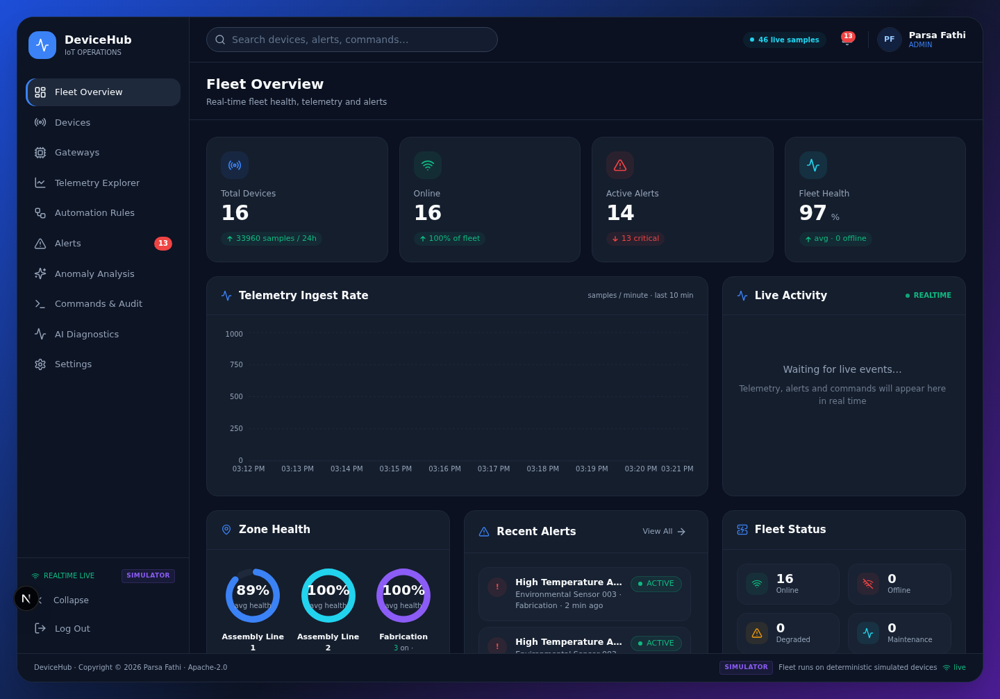
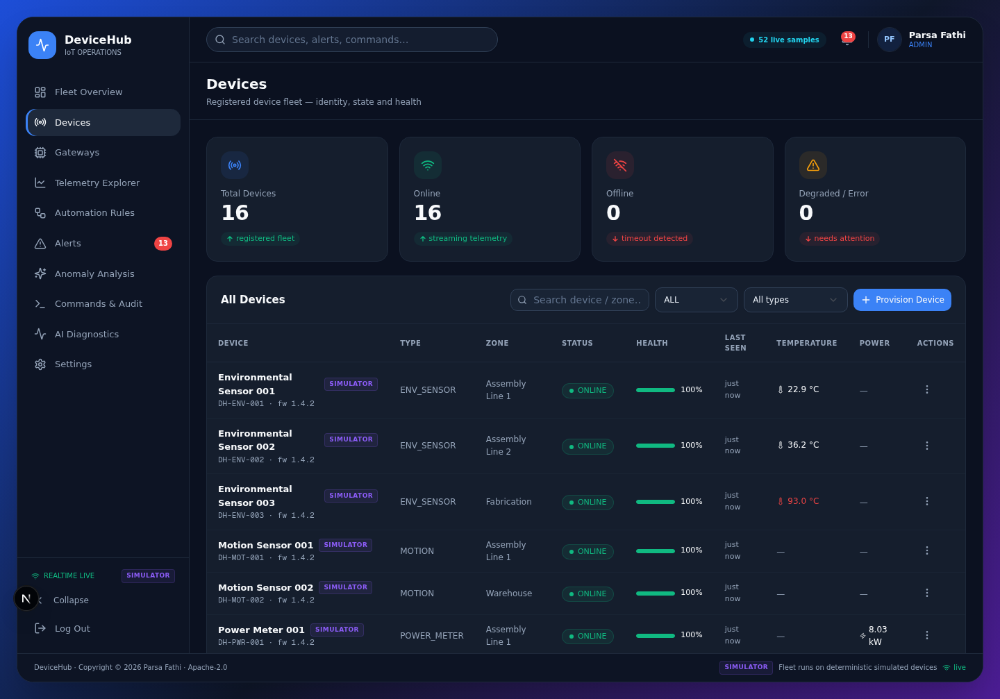
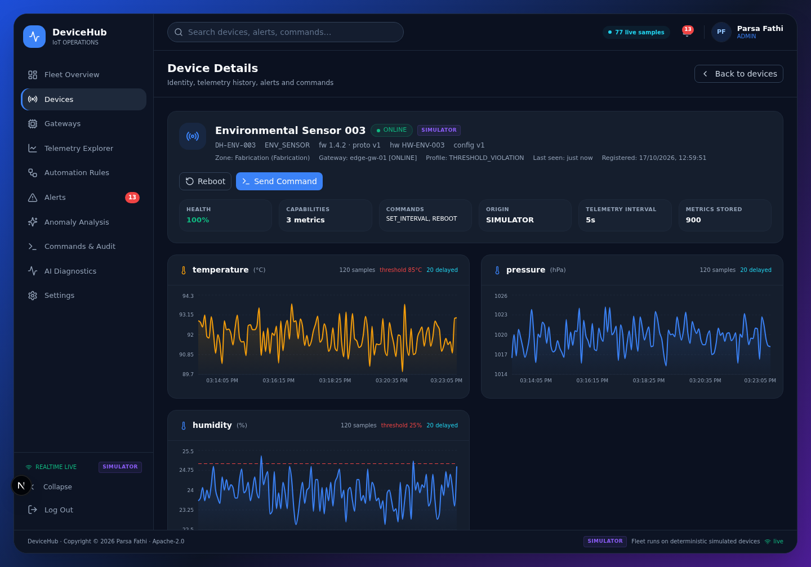
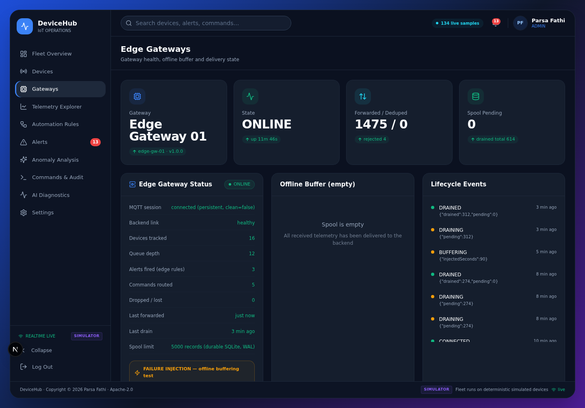
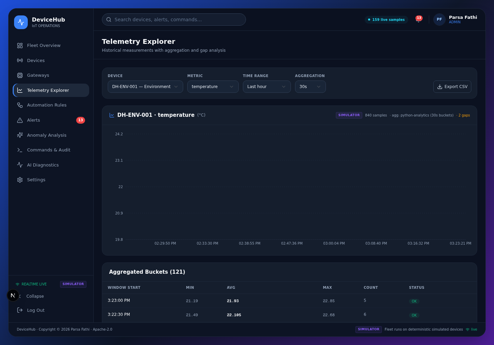
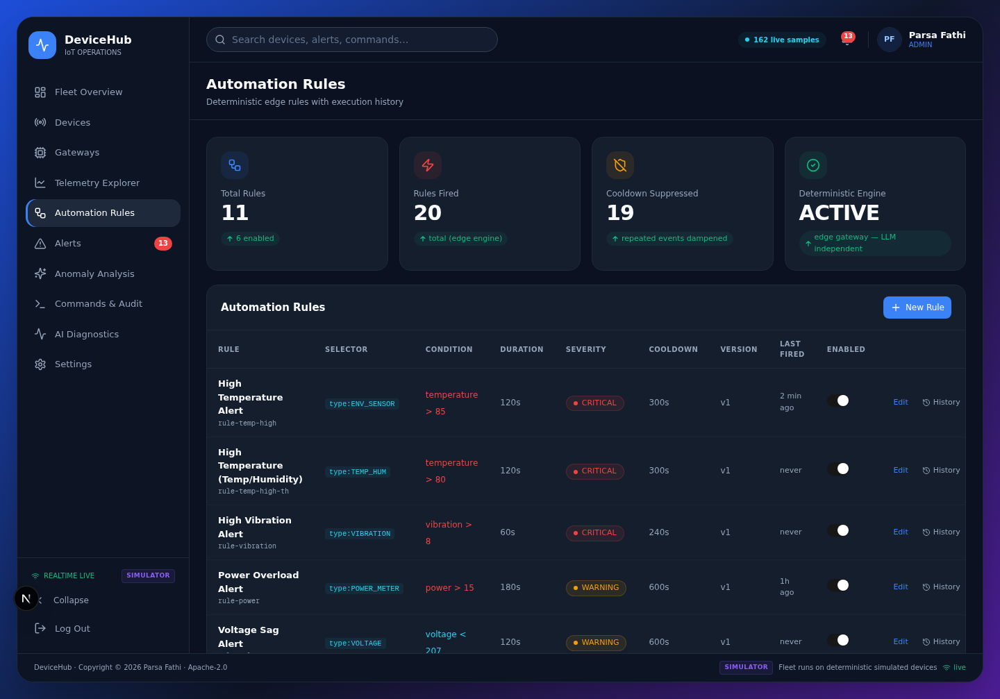
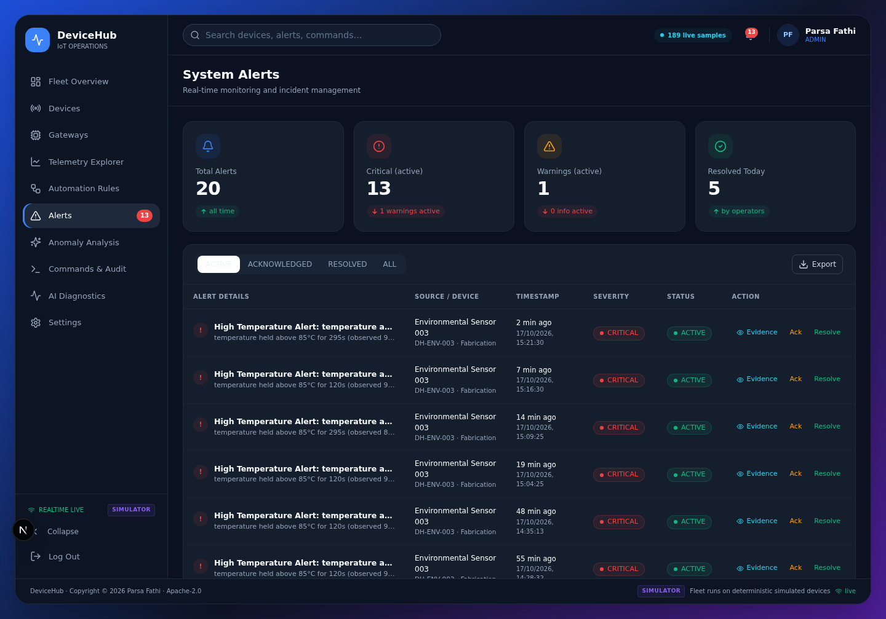
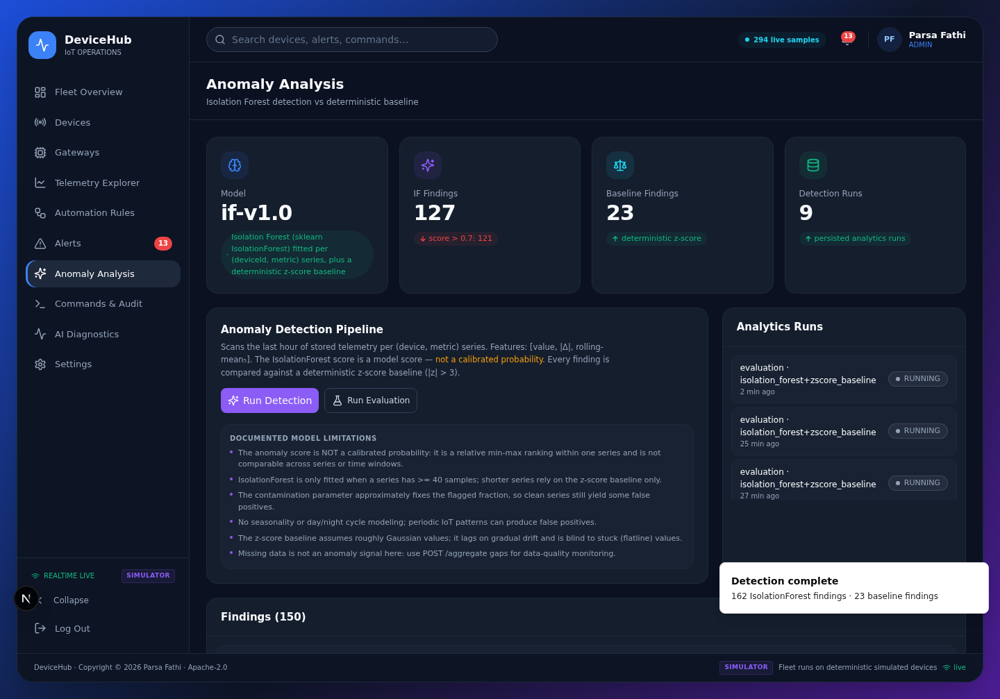
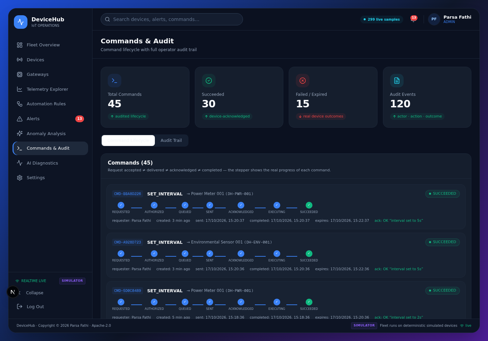
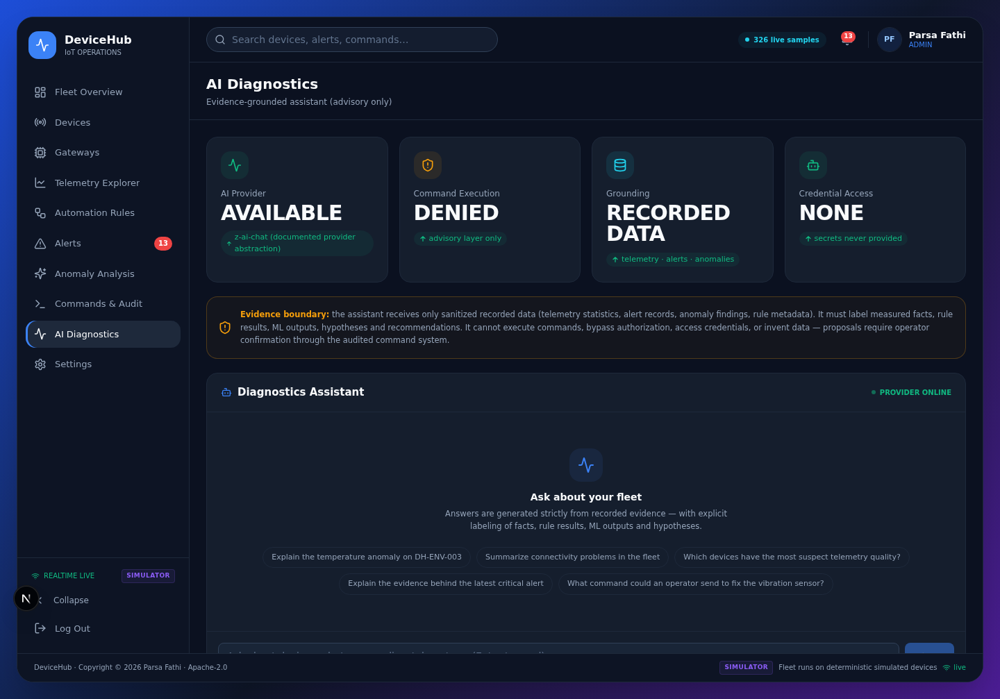

### Recorded test runs (GIFs)

The following recordings are real, unscripted test runs captured from the live platform
(reproducible via the scripts in `tests/gifs/`):

| Test recording | What it shows |
|---|---|
| 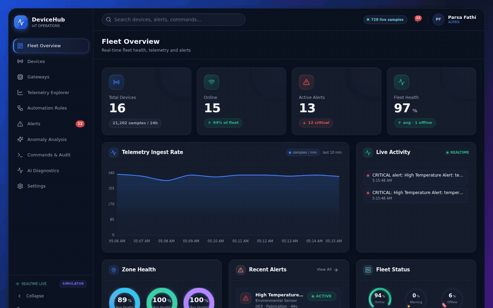 | Login → Fleet Overview streaming realtime telemetry, alerts and activity over socket.io |
| 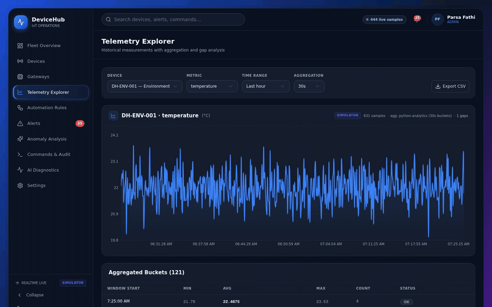 | Device/metric/range selection; red threshold overlay on the THRESHOLD_VIOLATION device; aggregation buckets |
| 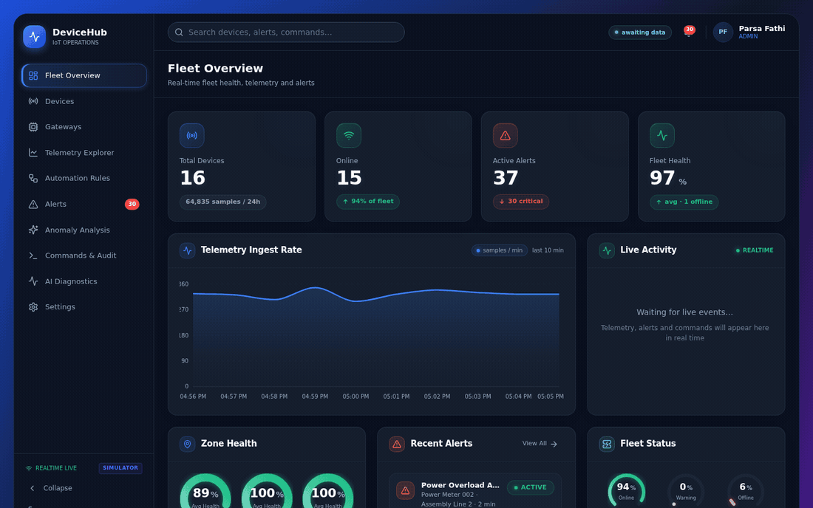 | SELF_TEST command dispatched via MQTT → device acknowledgement → lifecycle stepper reaches SUCCEEDED with ack detail |
| 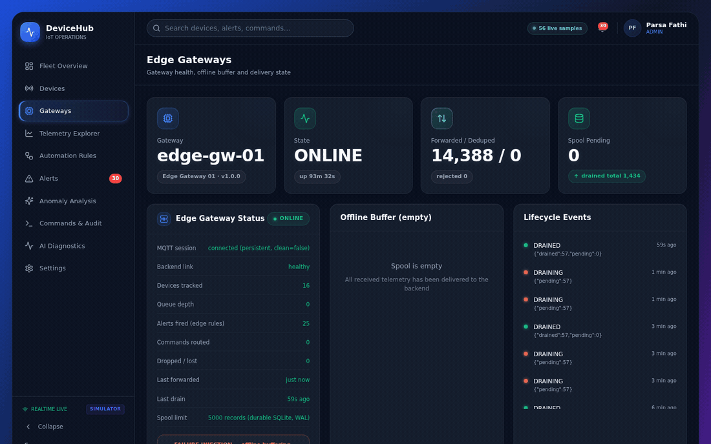 | **Failure injection:** 90 s backend outage → gateway enters BUFFERING, 158 records spool to durable SQLite → outage ends → automatic drain → spool empty + DRAINED event |
| 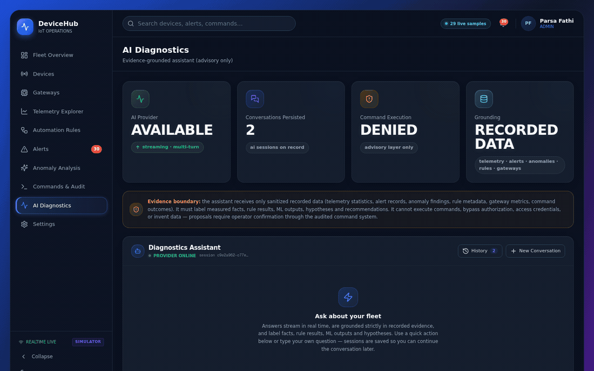 | Evidence-grounded answer with `[measured fact]` / `[rule result]` / `[hypothesis]` labels and evidence footer |
| 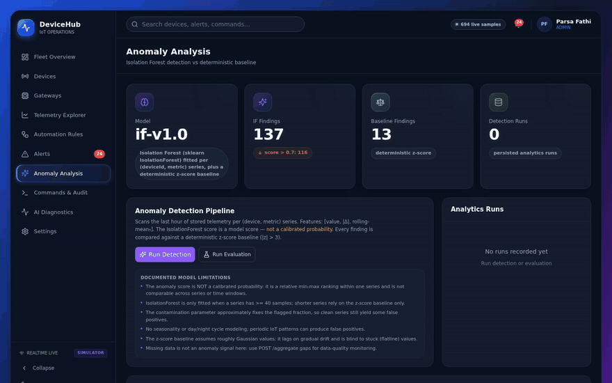 | IsolationForest + z-score baseline run over stored telemetry; findings with model scores |

---

## Quick start

Requirements: [Bun](https://bun.sh), Python 3.12 with `fastapi`, `uvicorn`, `scikit-learn`, `numpy`, `httpx`, `pytest` (for the analytics service), and a C compiler (gcc — only if you build the protocol library).

```bash
# 1. Web/backend
bun install
echo 'DATABASE_URL=file:/home/z/my-project/db/custom.db' > .env
bunx prisma db push          # create the SQLite schema
bun prisma/seed.ts           # seed users, gateway, 16 devices, 6 rules (idempotent upserts)
bun run dev                  # Next.js on :3000

# 2. MQTT broker
cd mini-services/broker && bun install && bun run dev          # :1883

# 3. Device simulator fleet
cd mini-services/simulator && bun install && bun run dev       # :3012

# 4. Edge gateway
cd mini-services/gateway && bun install && bun run dev         # :3011

# 5. Realtime
cd mini-services/realtime && bun install && bun run dev        # :3013

# 6. Analytics (Python)
cd mini-services/analytics
python3 -m pip install -r requirements.txt
bun run dev                                                   # :3014 (uvicorn)

# 7. C protocol library (optional)
cd protocol-c && make test    # 26 tests / 519 assertions
```

Start order matters: broker → simulator → gateway → backend → realtime/analytics. The gateway reconnects to the broker automatically, so a different order still converges — but broker-first avoids initial reconnect noise.

Demo accounts (seeded):

| Username | Password | Role |
|---|---|---|
| `admin` | `admin123` | ADMIN |
| `operator` | `operator123` | OPERATOR |
| `viewer` | `viewer123` | VIEWER |

Port map:

| Port | Service |
|---|---|
| 3000 | Web client + Next.js REST API |
| 1883 | MQTT broker (aedes) |
| 3011 | Edge gateway admin API |
| 3012 | Simulator control API |
| 3013 | Realtime (socket.io) |
| 3014 | Python analytics (FastAPI) |

Environment variables (all optional, defaults shown):

| Variable | Default | Used by |
|---|---|---|
| `DATABASE_URL` | — (required) | backend / Prisma |
| `DH_MQTT_URL` | `mqtt://localhost:1883` | gateway, simulator |
| `DH_BACKEND_URL` | `http://localhost:3000` | gateway, simulator, analytics |
| `DH_REALTIME_URL` | `http://localhost:3013` | gateway |
| `DH_INTERNAL_TOKEN` | `dev-internal-token` | all internal API callers |

---

## MQTT topics

| Topic | Direction | QoS | Retained | Payload |
|---|---|---|---|---|
| `device/{id}/telemetry` | device → gateway | 1 | no | protocol v1 JSON envelope |
| `device/{id}/status` | device → gateway | 1 | yes | heartbeat: `{deviceId, state, health, …}` |
| `device/{id}/command` | gateway → device | 1 | no | command envelope `{v, commandId, deviceId, action, payload, issuedAt, expiresAt}` |
| `device/{id}/ack` | device → gateway | 1 | no | `{commandId, code, detail}` with code ∈ OK / REJECTED / UNSUPPORTED / ERROR |
| `gateway/{id}/status` | gateway → broker | 1 | yes | gateway state + metrics (CONNECTED / BUFFERING / ONLINE / OFFLINE) |

The gateway uses a **persistent MQTT session** (`clean: false`), so the broker queues QoS 1 messages while the gateway is reconnecting. More detail: [docs/fa/MQTT_FA.md](docs/fa/MQTT_FA.md) (Persian) and `mini-services/broker/index.ts`.

---

## DeviceHub protocol v1

**JSON envelope** (what the platform actually exchanges over MQTT):

```json
{
  "v": 1,
  "deviceId": "DH-ENV-001",
  "msgId": "DH-ENV-001-000123",
  "seq": 123,
  "ts": 1760112000000,
  "metrics": [
    { "metric": "temperature", "value": 22.5, "unit": "°C", "quality": "GOOD" }
  ],
  "sim": true
}
```

- `v` — schema version, must be `1`
- `deviceId` — matches `^DH-[A-Z0-9-]+$` and must match the topic
- `msgId` — stable logical id; dedup happens on this at the gateway
- `seq` — per-device monotonic sequence; final dedup guard is the DB unique constraint `(deviceId, metric, sequence)`
- `ts` — milliseconds since Unix epoch UTC; rejected if > 5 min in the future or older than 24 h
- `metrics` — 1–16 entries; `quality` ∈ GOOD / SUSPECT / BAD; out-of-range values are **accepted but flagged SUSPECT**, only structurally invalid messages are rejected
- `sim` — `true` marks simulator data; it is stored and displayed as such

**Binary frame codec** — `protocol-c/` contains a portable C11 reference implementation of the binary wire format: 22-byte little-endian header (magic `0xD4`, version, msgType, flags, payloadLen ≤ 1024, seq, ts) with CRC-32 (IEEE 802.3) integrity. Telemetry payload is 11 bytes (metricId, quality, IEEE754 double); status payload is exactly 12 bytes (10 documented fields + 2 reserved); ACK and ERROR payloads are variable-length. The library has **26 tests / 519 assertions passing, including an ASan+UBSan-clean run** on gcc 14.2. Byte-level tables: [protocol-c/README.md](protocol-c/README.md).

---

## Device model & states

Devices are identified by an immutable logical id (`DH-ENV-001`), carry a type (`ENV_SENSOR`, `TEMP_HUM`, `MOTION`, `POWER_METER`, `VIBRATION`, `VOLTAGE`, `STATUS`), a zone/group, firmware/protocol versions, and a capabilities record (metrics + supported commands).

Device state machine: `UNPROVISIONED → PROVISIONED → ONLINE ⇄ OFFLINE`, with `DEGRADED`, `MAINTENANCE`, `ERROR`, `RETIRED` also available. In this deployment:

- a device becomes **ONLINE** when the gateway sees telemetry/heartbeat from it
- a device becomes **OFFLINE** when no message arrives for **45 s** (gateway monitor) or it explicitly reports offline
- gateway states: `PROVISIONED | ONLINE | OFFLINE | DEGRADED | ERROR | RETIRED`, plus `BUFFERING` while it is locally buffering during a backend outage

---

## Telemetry schema

Each stored sample has **dual timestamps**:

- `sampleTs` — the source timestamp from the device (`ts` in the envelope); preserved through buffering and drain, never overwritten
- `receivedTs` — server receipt time

Additional fields: `metric`, `value`, `unit`, `quality` (GOOD/SUSPECT/BAD), `messageId`, `sequence`, `delayed`, `simulated`.

Two reliability semantics worth knowing:

- **Delayed data is preserved, never discarded.** A sample arriving after newer samples for the same `(deviceId, metric)` is stored with `delayed: true`.
- **Dedup is two-layer.** The gateway drops repeated `msgId` deliveries (in-memory window of 8000 ids); the backend enforces a unique constraint on `(deviceId, metric, sequence)` as the final guard — duplicates are counted, not stored.

---

## Automation semantics

Rules are evaluated **at the edge gateway**, deterministically, on every validated telemetry batch:

```
condition (ABOVE/BELOW threshold) must hold for durationSec
  → FIRE (create alert with evidence) unless within cooldownSec of last fire
  → otherwise SUPPRESSED_COOLDOWN
condition breaks → NOT_MET, hold-timer reset
condition first met → CONDITION_MET_WAITING
```

Every outcome is recorded as a `RuleExecution` (`FIRED | SUPPRESSED_COOLDOWN | CONDITION_MET_WAITING | NOT_MET | ERROR`). Fired alerts carry evidence JSON (observed value, threshold, held seconds, rule version, sample timestamp, quality). Rules are versioned on update and refreshed at the gateway every 15 s.

Seeded rules:

| Rule | Selector | Metric | Condition | Hold | Severity | Cooldown |
|---|---|---|---|---|---|---|
| High Temperature Alert | `ENV_SENSOR` | temperature | > 85 °C | 120 s | CRITICAL | 300 s |
| High Temperature (Temp/Humidity) | `TEMP_HUM` | temperature | > 80 °C | 120 s | CRITICAL | 300 s |
| High Vibration Alert | `VIBRATION` | vibration | > 8 mm/s | 60 s | CRITICAL | 240 s |
| Power Overload Alert | `POWER_METER` | power | > 15 kW | 180 s | WARNING | 600 s |
| Low Humidity Alert | `TEMP_HUM` | humidity | < 25 % | 300 s | INFO | 900 s |
| Voltage Sag Alert | `VOLTAGE` | voltage | < 207 V | 120 s | WARNING | 600 s |

---

## Commands

Lifecycle:

```
REQUESTED → AUTHORIZED → QUEUED → SENT → (ACKNOWLEDGED) → SUCCEEDED / FAILED
                                  └── no ack within 30 s → FAILED
                                                        └── not dispatched in time → EXPIRED
```

- Actions are **validated against device capabilities** server-side (422 for unsupported actions, audited as denials).
- Success is **never** reported at API-accept time — only a real device acknowledgement routed back through MQTT completes the lifecycle.
- Ack codes: `OK`, `REJECTED`, `UNSUPPORTED`, `ERROR`.
- Every state change is audited (actor, action, resource, outcome, sanitized detail).

---

## Anomaly detection (ML) — real evaluation numbers

Two models run side by side (Python service, port 3014):

- **IsolationForest** (`if-v1.0`): per `(deviceId, metric)` series with ≥ 40 samples, features `[value, |Δ|, rolling-mean₅]`, score = min-max normalized `-decision_function`. **The score is not a calibrated probability.**
- **z-score baseline** (deterministic): flags `|z| > 3`, baselineScore = `clip(|z|/3, 0, 1)`.

Evaluation on a labeled synthetic dataset — 1179 samples, 146 labeled anomalies, 8 patterns (stable baseline, gradual drift, sudden spike, missing samples, noisy sensor, disconnected device, stuck values, out-of-range):

| Model | Precision | Recall | F1 | Detections | Mean delay |
|---|---|---|---|---|---|
| IsolationForest | 0.365 | 0.158 | 0.220 | 63 (23 TP / 40 FP) | ~1.2 samples |
| z-score baseline | 0.909 | 0.069 | 0.127 | 11 (10 TP / 1 FP) | 0.0 samples |

Per-pattern highlights: on sudden spikes both detect everything (IF 0.625/1.000/0.769, z-score 1.000/1.000/1.000); the z-score baseline is **completely blind to gradual drift** (IF gets 0.750/0.200/0.316, detection delay 12 samples); IsolationForest found 10/11 anomaly events. Flatline/stuck patterns are caught mainly at transitions.

Read this as an honest characterisation, not a benchmark claim: the IsolationForest is a broad-change detector with substantial false positives; the z-score baseline is precise but low-recall. 22/22 pytest tests pass for the analytics service.

---

## AI diagnostics — and its safety boundary

`POST /api/ai/diagnostics` answers operational questions using the `z-ai-chat` provider, with the boundary **enforced in code, not by the model's goodwill**:

- The model receives **only sanitized evidence**: fleet/device summaries, recent alerts, anomaly findings, rule metadata, recent telemetry statistics. No credentials, no secrets.
- Answers must label statements as `[measured fact]`, `[rule result]`, `[ML output]`, `[hypothesis]`, or `[recommendation]`.
- The assistant **cannot execute commands**. Verified by test: asked to execute an action, it refuses and proposes the command an authorized operator could submit through the audited flow. After that exchange, the count of AI-sourced commands in the audit log is **0**.
- If the AI provider is unavailable, the rest of the platform is fully operational (the endpoint degrades; the data path does not).

---

## Auth & roles

Session-cookie authentication (`dh_session`, httpOnly, SameSite=Lax, 24 h TTL; PBKDF2-SHA256 password hashing, 60 000 iterations). Roles are enforced **server-side** on every API route:

| Capability | ADMIN | OPERATOR | VIEWER |
|---|---|---|---|
| View all views & read APIs | ✔ | ✔ | ✔ |
| Send commands | ✔ | ✔ | ✘ (403, audited) |
| Manage rules (CRUD + versioning) | ✔ | ✔ | ✘ |
| Acknowledge/resolve alerts | ✔ | ✔ | ✘ |
| Simulator & gateway controls | ✔ | ✘ | ✘ |
| User management | ✔ | ✘ | ✘ |

Internal APIs (under `/api/internal/*`) accept no session — they require the `X-Internal-Token` header shared by the gateway, simulator and analytics services (`DH_INTERNAL_TOKEN`; default dev token must be changed in production). More: [SECURITY.md](SECURITY.md).

---

## Testing

Three shell suites run against the **live platform** (all services up). These are the real results from this environment:

| Suite | Command | Result |
|---|---|---|
| Functional | `bash tests/api.test.sh` | **45/45 passed** |
| Security & AI-safety | `bash tests/security.test.sh` | **37/37 passed** |
| Reliability / failure injection | `bash tests/failure.test.sh` (~3 min) | all scenario groups passed |

Coverage highlights:

- **api.test.sh** — auth, fleet, telemetry, command lifecycle with real device acks, alerts, rules versioning, audit, services, ML evaluation, AI grounding.
- **security.test.sh** — 401/403 on unauthenticated/unauthorized access, internal-token enforcement, forged cookies, invalid device identities, audited denials, payload limits, secret scan, AI safety (cannot execute commands), logout invalidation.
- **failure.test.sh** — duplicate delivery deduped; delayed telemetry preserved + flagged; 30 s backend outage → 89 records spooled → automatic drain → `DRAINED` event; gateway `kill -9` with 57 spooled records → restart → drain-on-boot; malformed input rejected; oversized batch → 413; device silence → OFFLINE timeout → resume → ONLINE; MQTT broker kill → reconnect.

Unit suites: `cd protocol-c && make test` (26 tests / 519 assertions, plus `make test-asan`) and `cd mini-services/analytics && python3 -m pytest tests/ -v` (22/22).

CI (`.github/workflows/ci.yml`) runs what can run without the live platform: the C test suite, the Python pytest suite, web lint, and shell-syntax checks on the three live suites. The live suites themselves need a running platform and are **not** run in CI — this is documented in the workflow file.

---

## Project layout

```
.
├── prisma/                  # schema + seed (15 models: users, devices, telemetry, commands, alerts, rules, audit, anomalies…)
├── src/
│   ├── app/                 # Next.js: single-page UI at / + REST API routes (public + /api/internal/*)
│   ├── components/
│   │   ├── devicehub/       # the 11 views (overview, devices, device-detail, gateways, telemetry-explorer,
│   │   │                    #   automation, alerts, anomaly, commands-audit, ai-diagnostics, settings, shell, login)
│   │   └── ui/              # shadcn/ui primitives
│   ├── hooks/               # use-realtime (socket.io) and others
│   └── lib/                 # auth (sessions/roles), db, services, store
├── mini-services/
│   ├── broker/              # aedes MQTT broker (:1883)
│   ├── simulator/           # deterministic device fleet + control API (:3012)
│   ├── gateway/             # edge gateway: validation, dedup, durable spool, automation, command routing (:3011)
│   ├── realtime/            # socket.io event fan-out (:3013)
│   └── analytics/           # Python FastAPI: aggregates, anomaly detection, evaluation (:3014)
├── protocol-c/              # C11 binary wire-protocol library + 26-test suite
├── tests/                   # api.test.sh, security.test.sh, failure.test.sh (live-platform suites)
├── docs/fa/                 # Persian documentation
└── .github/                 # CI, issue templates, CODEOWNERS, dependabot
```

---

## Documented limitations

Honest scope of **this build environment** (not claims about the platform design):

- **SQLite** (via Prisma) is used instead of PostgreSQL. The data layer is behind Prisma, so the schema is portable, but only SQLite was built and tested here.
- The **edge gateway is a TypeScript service**. The C++ gateway named in the original architecture document maps to this component — same responsibilities (protocol validation, dedup, buffering, automation, command routing), different implementation language.
- **No mobile clients** (no Flutter/Kotlin apps were built) and **no Spring Boot backend**.
- **No Docker execution** in this environment; the repo contains no Dockerfiles and CI does not publish images.
- **No physical-hardware testing.** Every device in the fleet is a simulator; the C protocol library is real and tested (gcc 14.2), but it was not exercised against physical hardware.
- The **C protocol library** (`protocol-c/`) *is* real, tested, and ASan-clean; the live MQTT path in this deployment carries the JSON envelope form of protocol v1.
- All fleet data is simulator data, clearly labelled (`sim: true` on the wire, `simulated` in storage, SIMULATOR origin in the UI).
- The dev MQTT broker runs **without TLS and allows anonymous clients** — see [SECURITY.md](SECURITY.md) for production requirements.
- No third-party security audit has been performed. The 37/37 security suite is a self-test, not a certification.

---

## Roadmap notes

Directions that follow naturally from what exists (not promises):

- PostgreSQL deployment path (Prisma schema is already database-agnostic in shape).
- TLS + client certificates on the MQTT broker; replacing the dev internal token with per-service credentials.
- Feeding the binary C codec into the live path (a device-side firmware implementation against `protocol-c/`).
- Tighter ML: calibrated scores, per-metric feature sets, drift-specific detectors (the evaluation shows where each model is blind).
- Historical telemetry retention/rollup beyond the current store.

---

## License

Apache License 2.0 — Copyright © 2026 Parsa Fathi. The full text is in [LICENSE](LICENSE); third-party attributions in [THIRD_PARTY_NOTICES.md](THIRD_PARTY_NOTICES.md).

Owner: [Parsa Fathi](https://github.com/ParsaFathii) · Repository: [ParsaFathii/DeviceHub](https://github.com/ParsaFathii/DeviceHub)
